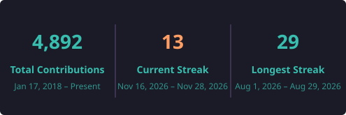
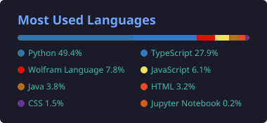

## 👋🏾 Hey, I'm Maxwell Agyapong - Backend & AI/ML Engineer from Ghana 🇬🇭
Building at the intersection of AI and distributed systems. 
Currently working on real-time on-chain risk intelligence — LightGBM classifiers, LLM sentiment scoring, and rug-pull detection across 15+ chains.

Previously scaled IoT backends to 2.5M+ devices and trading engines to 100K+ trx/sec.

---
### 🚀 About Me 
❤️ I love building intelligent systems, and automating real-world business logic  
📊 Passionate about AI and ML

---
### 🧱 Tech I Work With
Stack: Python · Java · JavaScript · Rust · Go · FastAPI · Django · Spring Boot · Kafka · PyTorch · LangChain · Postgres · K8s 

---
### 📈 GitHub Stats

 

Includes private contributions · auto-updated every 12h

---

### 💬 Let's Connect

Got a question? Building something exciting? I'm always up for a technical deep dive or a smart hustle.

---
